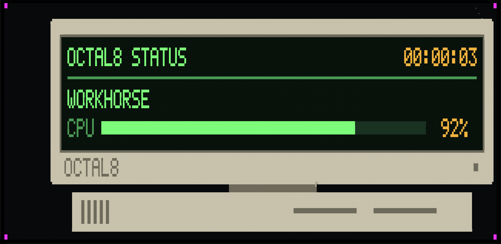

# Phosphor

Phosphor puts a moving picture onto a plain terminal using only ordinary characters, and
proves what the terminal really showed by photographing and filming the window.

No image protocol. Nothing to install in the terminal. One small program.



That is a photograph of Apple's Terminal. Every letter, bar and edge is made of block
characters. The pink squares in the corners are marks the checker uses to line the photograph
up with the picture that was meant.

## The idea

A terminal is a grid of cells. Each cell shows one character in two colours. Some characters
are blocks that fill part of a cell, so a cell can be split into dots: 1 × 2, 2 × 2, 2 × 3 or
2 × 4. That makes a terminal a small pixel screen with one rule: two colours per cell.

Phosphor draws everything into a canvas of dots, text included. For each cell it picks the
block and the two colours closest to the dots underneath, sends only the cells that changed,
and paces itself to what the terminal can really paint.

Each terminal is different, so Phosphor keeps a **profile** of each one: which blocks it
draws, which shortcuts it gets wrong, what it charges in time for bytes and colour changes,
and how often it paints. `CONTEXT.md` defines every word used here and in the code.

## Try it

```
cargo build --release
target/release/phosphor play bounce          # q quits
target/release/phosphor play develop picture.png --thing
```

`play bounce` shows the benchmark: a retro computer with a live status screen drifting around
the window. `play develop` shows a large picture arriving coarse and sharpening while a small
square keeps moving.

## What has been measured

On one Mac (macOS 27.2, M1 Max), by photographing and filming the real window. *Accepted*
means the terminal took frames at that rate. *Seen* means a film shows them.

| | Apple's Terminal 2.15 | Ghostty 1.4.0 |
|---|---|---|
| Wrong dots in photographs of the benchmark | 0 in 12 of 12 cases | not photographed |
| Blocks it draws | halves and quarters | all four |
| A near-empty test pattern sent at 60 a second | seen at about 22 | seen at 50 to 57 |
| The colour benchmark sent at 60 a second | seen at 14 to 17 | seen at 53 to 55 on the finest blocks |
| The colour benchmark paced at 14 a second | every frame seen, 5 films of 5 | — |

Apple's Terminal reads frames at 60 a second and paints over most of them before they reach
the screen. So Phosphor paces it at 14, where every frame sent is seen. The spacing there is
close to even, not even. Details, methods and every number: `docs/measurements/`.

## Known limits

- The smallest step is one dot. A smaller font means smaller dots and more cells to paint.
- Two colours per cell. Half blocks avoid the problem; finer blocks can bleed.
- Text drawn from dots is larger than the terminal's own text.
- Ghostty's prices are not measured yet, so the governor is far too cautious there and
  crushes colour.
- Only two terminals have been measured, on one computer. The witness (photographs and film)
  runs on macOS only.
- This is early software. Expect things to change.

## The parts

| Part | Its job | Where |
|---|---|---|
| Composition | What should be seen, and how it changes | `crates/compose` |
| Foundry | Fonts and pictures into dots | `crates/foundry` |
| Presentation | The best picture a surface can carry in its budget | `crates/fit`, `crates/encode`, `crates/govern` |
| Surface | One real terminal, known truthfully | `crates/surface` |
| Witness | What was really shown, by photograph and film | `crates/witness` |
| Bench | A strict pretend terminal for tests | `crates/bench` |
| Kernel | The few types all parts share | `crates/kernel` |
| The program | `phosphor` | `crates/cli` |
| The benchmark app | Drawn with Phosphor, not part of it | `apps/bounce` |

`docs/architecture.md` shows how they join. `lab/` and `rigs/` hold the throwaway experiments
the design came from.

## How it was built

Phosphor was written by AI agents working in parallel from written issues, each owning one
part, with a shared vocabulary and a small shared kernel agreed first. Issue numbers such as
"#46" in the documents refer to that private build log, not to this repository's issues.

## Checks

Every pull request, and every push to `main`, runs `cargo fmt --all -- --check`,
`cargo clippy --workspace -- -D warnings` and `cargo test --workspace` on GitHub's runners.
Tests that need a screen are marked `#[ignore]` and do not run there.

## Licence

MIT. See `LICENSE`. JetBrains Mono, used as a test typeface, is under the SIL Open Font
License; its licence sits beside each copy.
