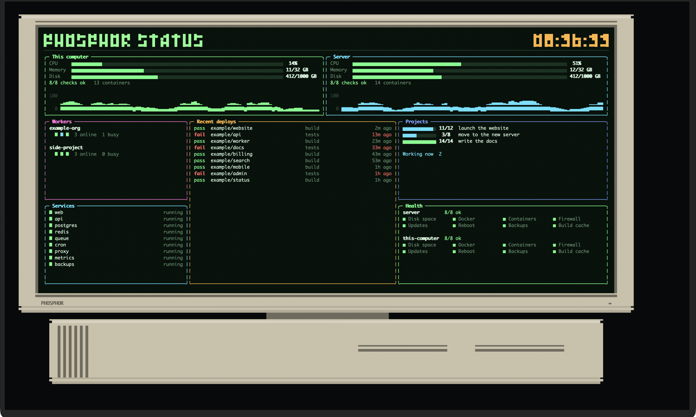

# Phosphor

Animations for your terminal, built on [OpenTUI](https://github.com/anomalyco/opentui).



## Screensaver

A retro computer drifts around the terminal and bounces off the edges. Its screen is a
status board made of cards that you choose: your servers, your services, your builds,
anything a script can print.

```
bun install
bun run screensaver
```

- Drag the computer to move it. Let go mid-drag to throw it.
- Click a card to fill the screen with it. Click again to go back.
- Scroll, or press `+` and `-`, to change the speed.
- `space` pauses, `s` changes the screen colour, `c` the case colour, `1`–`9` shows one
  card, `esc` shows them all, and `q` quits.

Out of the box it shows example cards with made-up data. The **This computer** card is
real and shows your own computer's numbers.

### Your own cards

Copy [`apps/screensaver/example.json`](apps/screensaver/example.json) to
`~/.config/phosphor/screensaver.json` (or pass `--settings file.json`) and edit it.

Each card has a **type** and a **source**:

```json
{ "id": "api", "type": "machine", "title": "API server", "color": "cyan",
  "source": { "url": "https://status.example.com/api.json", "every": 30 } }
```

| Type | Draws | Data |
|---|---|---|
| `machine` | processor, memory and disk bars, a line of facts, a processor chart | `{ cpu, memory: {used, total}, disk: {used, total}, facts, history }` |
| `list` | rows with a coloured tag, a label, a detail and a note on the right | `{ items: [{ tag, tone, label, detail, right }] }` |
| `progress` | progress bars, then facts and notes | `{ items: [{ label, done, total }], facts, lines }` |
| `checks` | groups of checks, failures first | `{ groups: [{ name, checks: [{ name, ok, detail }] }] }` |
| `dots` | a block per worker, coloured by state | `{ groups: [{ name, units: ["good", "busy", "bad"], note }] }` |
| `text` | lines of text | `{ lines: ["...", { text, tone }] }` |

A **tone** is `good`, `bad`, `busy`, `warn`, `dim` or `plain`. The full shapes are in
[`apps/screensaver/data.ts`](apps/screensaver/data.ts).

| Source | Reads | Refreshes |
|---|---|---|
| `{ "demo": "name" }` | made-up data that moves | every second |
| `{ "system": true }` | this computer's processor, memory and disk | every second |
| `{ "url": "…", "headers": {…} }` | JSON from a web address | every 30 s |
| `{ "file": "status.json" }` | JSON or plain lines from a file | every 5 s |
| `{ "command": "./my-script" }` | JSON or plain lines a command prints | every 30 s |

Add `"every": seconds` to change how often a source refreshes, and `"path": "a.b[0]"` to
take one part of the data. Cards with the same source share one fetch, so one script can
feed every card: print `{ "web": {…}, "db": {…} }` and give each card its `path`.

The `layout` puts cards in rows of columns. Heights and widths are shares of the screen:

```json
"layout": [
  { "height": 2, "columns": [["web"], ["db"]] },
  { "height": 5, "columns": [{ "width": 30, "cards": ["jobs", "health"], "heights": [1, 2] }, ["deploys"]] }
]
```

Leave `layout` out and the cards are placed three to a row. The other settings are
`title`, `label` (the text on the computer's chin), `speed`, `screen` (`color`, `green`,
`amber` or `white`), `case` (`beige`, `graphite`, `white` or `rainbow`), `size` (the
computer's share of the window, 0.5 to 1) and `quietHours` (such as `"23:00-07:00"`, when
the screen goes dark).

## Building a program file

```
bun install --os='*' --cpu='*'
bun scripts/build.ts
```

`dist/` then holds one file per app and computer type, such as
`phosphor-screensaver-linux-x64`. Each runs on its own, with nothing else installed.

## Checks

`bun run check` type-checks and runs the tests. `scripts/shot.sh out.png` photographs the
screensaver in Apple's Terminal.

The earlier version of Phosphor, a terminal drawing engine written in Rust, is kept under
the `rust-engine-final` tag.

## Licence

MIT. See `LICENSE`.
