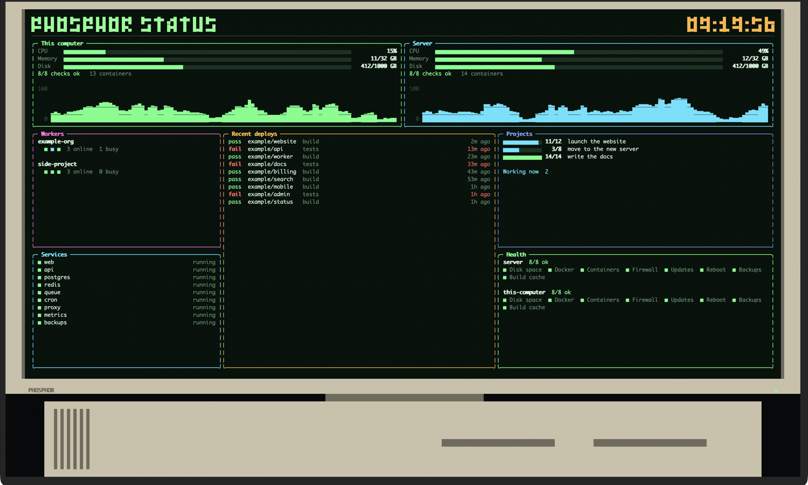

# Phosphor

Animations for your terminal, built on [OpenTUI](https://github.com/anomalyco/opentui).



## Dashboard

A retro computer fills the terminal, its screen a status board made of cards that you
choose: your servers, your services, your builds, anything a script can print. It stays
still so you can read it. Numbers and bars slide to new values, and new rows glow for a
moment.

Leave it alone for 30 seconds and a screensaver takes over the whole window for 30
seconds: a big title made and unmade by falling characters, scrambled letters, sweeping
beams or a swarm of pixels. Move the mouse, click or press a key and the dashboard comes
straight back, and the 30 seconds start again.

```
bun install
bun run dashboard
```

- Click a card to fill the screen with it. Click again to go back.
- `space` starts the screensaver now, `s` changes the screen colour, `c` the case colour,
  `1`–`9` shows one card, `esc` shows them all, and `q` quits.

Out of the box it shows example cards with made-up data. The **This computer** card is
real and shows your own computer's numbers.

### Your own cards

Copy [`apps/dashboard/example.json`](apps/dashboard/example.json) to
`~/.config/phosphor/dashboard.json` (or pass `--settings file.json`) and edit it.

Each card has a **type** and a **source**:

```json
{ "id": "api", "type": "machine", "title": "API server", "color": "cyan",
  "source": { "url": "https://status.example.com/api.json", "every": 30 } }
```

| Type | Draws | Data |
|---|---|---|
| `machine` | processor, memory and disk bars, a line of facts, a processor chart | `{ cpu, memory: {used, total}, disk: {used, total}, facts, history }` |
| `list` | rows with a coloured tag, a label, a detail and a note on the right | `{ items: [{ tag, tone, label, detail, right }] }` |
| `progress` | progress bars, then facts and notes | `{ items: [{ label, done, total }], facts, lines }` |
| `checks` | groups of checks, failures first | `{ groups: [{ name, checks: [{ name, ok, detail }] }] }` |
| `dots` | a block per worker, coloured by state | `{ groups: [{ name, units: ["good", "busy", "bad"], note }] }` |
| `text` | lines of text | `{ lines: ["...", { text, tone }] }` |

A **tone** is `good`, `bad`, `busy`, `warn`, `dim` or `plain`. The full shapes are in
[`apps/dashboard/data.ts`](apps/dashboard/data.ts).

| Source | Reads | Refreshes |
|---|---|---|
| `{ "demo": "name" }` | made-up data that moves | every second |
| `{ "system": true }` | this computer's processor, memory and disk | every second |
| `{ "url": "…", "headers": {…} }` | JSON from a web address | every 30 s |
| `{ "file": "status.json" }` | JSON or plain lines from a file | every 5 s |
| `{ "command": "./my-script" }` | JSON or plain lines a command prints | every 30 s |

Add `"every": seconds` to change how often a source refreshes, and `"path": "a.b[0]"` to
take one part of the data. Cards with the same source share one fetch, so one script can
feed every card: print `{ "web": {…}, "db": {…} }` and give each card its `path`.

The `layout` puts cards in rows of columns. Heights and widths are shares of the screen:

```json
"layout": [
  { "height": 2, "columns": [["web"], ["db"]] },
  { "height": 5, "columns": [{ "width": 30, "cards": ["jobs", "health"], "heights": [1, 2] }, ["deploys"]] }
]
```

Leave `layout` out and the cards are placed three to a row. The other settings are
`title`, `label` (the text on the computer's chin), `screen` (`color`, `green`, `amber` or
`white`), `case` (`beige`, `graphite` or `white`), `size` (the computer's share of the
window, 0.5 to 1), `quietHours` (such as `"23:00-07:00"`, when the screen goes dark),
`idle` (seconds before the screensaver), `screensaver` (seconds it runs; 0 turns it off),
`saverText` (its title; the label by default) and `effects` (any of `rain`, `decrypt`,
`beams` and `swarm`; all by default).

### Your own logo

Draw a logo in a text file with the block characters `█`, `▀` and `▄`, one cell per
character, and name it in the settings. File names are found from the settings file's
folder.

```json
"logo": "logo.txt",
"saverArt": ["logo.txt", "symbol.txt"]
```

`logo` takes the title's place at the top of the screen when there is room. `saverArt` gives
the screensaver pictures to show instead of its title, one per effect in turn, made large out
of whole cells.

## Building a program file

```
bun install --os='*' --cpu='*' --libc='*'
bun scripts/build.ts
```

`dist/` then holds one file per app and computer type, such as
`phosphor-dashboard-linux-x64`. Each runs on its own, with nothing else installed.

Ready-made program files are on the
[releases page](https://github.com/wlkr-si/phosphor/releases). Pushing a version tag such as
`v0.1.0` builds and publishes them.

## Checks

`bun run check` type-checks and runs the tests. `scripts/shot.sh out.png` photographs the
dashboard in Apple's Terminal, and `scripts/shot.sh dir/ 10` takes stills for ten seconds
to check animation. `scripts/shot-ghostty.sh dir/` does the same in Ghostty. Add
`-- --sleep` to start on the screensaver.
`bun scripts/perf.ts` times drawing without a terminal, and `scripts/rate.sh dir` measures
how many bytes a second it sends.

The earlier version of Phosphor, a terminal drawing engine written in Rust, is kept under
the `rust-engine-final` tag.

## Licence

MIT. See `LICENSE`.
